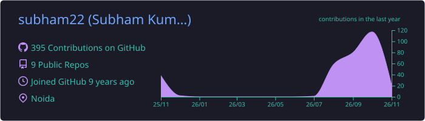
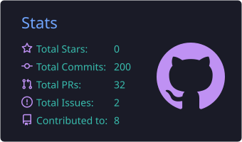
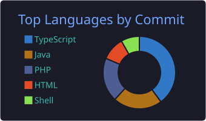
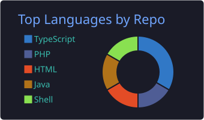

<!-- Header -->

  

  

  
  
  
  

  
  

---

## 👋 About me

I'm a **frontend-focused full-stack developer and Tech Lead** with **9+ years** of experience building enterprise web applications for clients including **Citi Bank, Elsevier and Fortune 500 companies**.

- 🏢 **Tech Lead at Coforge**: leading Angular development for a cargo handling platform
- 🔼 Recently led an **Angular v15 → v20 upgrade** on a large production app
- 🏦 Built **Citi's compliance application** from scratch in Angular 13
- 🧩 I care about **clean UI architecture, reusable component libraries and accessibility (WCAG)**
- 🤖 Now adding **Generative AI**: LLM integration (OpenAI & Claude APIs), prompt engineering and RAG
- 📍 Delhi NCR, India · 🌍 comfortable working async with teams in any time zone

---

## 🛠️ Tech stack

**Frontend**

  

**Backend & data**

  

**Generative AI**

  
  
  
  

**Tools & practices**

  

---

## 🚀 What I'm building

<table>
  <tr>
    <td width="50%" valign="top">
      <h3>🧭 Roamwise</h3>
      
<b>AI trip itinerary planner</b> that turns a trip idea into a structured, editable day-by-day plan, grounded in real place, weather and opening-hours data rather than a plain chatbot answer.

      

        
        
        
        
      

      
🟡 <i>In progress</i>

    </td>
    <td width="50%" valign="top">
      <h3>♿ A11yAudit</h3>
      
<b>Accessibility audit SaaS</b>: multi-tenant WCAG scanning with async processing. Adding LLM-generated fix suggestions and RAG over WCAG documentation.

      

        
        
        
        
      

      
🟡 <i>In development</i> · <a href="https://github.com/subham22/a11yaudit-landing">landing page repo</a>

    </td>
  </tr>
</table>

---

## 📊 GitHub stats

<!-- Cards are generated daily into this repo by .github/workflows/profile-summary-cards.yml -->

  

  
  
  

---

## 🤝 Let's work together

I'm open to **remote full-time roles** and **freelance projects**, especially:

`Angular upgrades & migrations` · `Angular bug fixes & performance` · `Adding AI features to Angular / Spring Boot apps`

  

